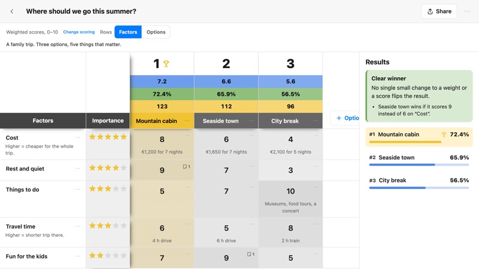
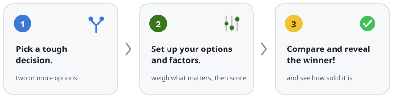
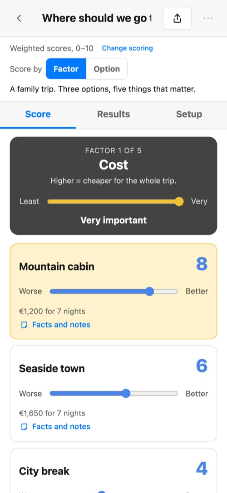
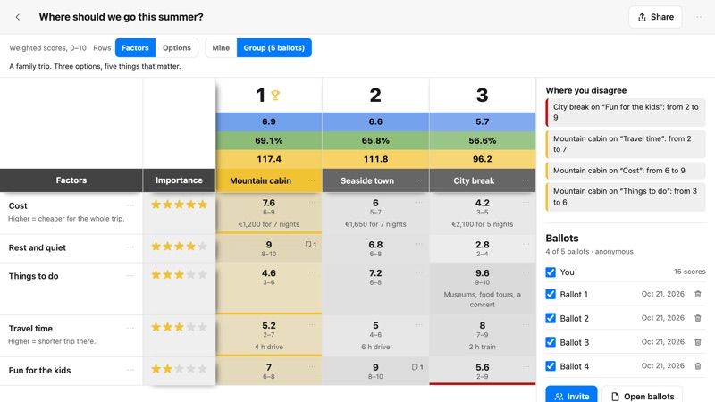

<p align="center">
  <picture>
    <source media="(prefers-color-scheme: dark)" srcset="docs/assets/logo-dark.svg">
    
  </picture>
</p>

<h1 align="center">doocide</h1>

<p align="center">
  <b>It's time to doocide.</b><br>
  Make better decisions with Doocide. Local-first: no server, no accounts, no tracking.
</p>

<p align="center">
  <a href="https://doocide.github.io"></a>
  <a href="https://doocide.github.io/#d=pVVNa9tAEP0rw1x62RjZiZ1WUEoolAaaHhpDoSGHjXbsXSLtursjOyb40t_TX9VfUlba2LJdx4aCLtK-9_TmY2eeUTlXGEWY9wU-GqswR0WFCcZZFEi2wByts4QClWSJ-TOaFlS527qqyKNANlwS5vhdkycI2tWlggXB1AFrEyA0wA9Rg0LhzYyjfI5XMJGVKZfA3sx6MNaeCFxzGgRMzJwi304DsJYMlWQm30OBpbRTzJGix8KTZFJXjDkOssHorJ-dDbJxluXN08uy7AcKrGfqFFgg5vjHGGjlYmJwQWaqmVQ8LWRJN_IJ834mcFZP9S3TLGDeXwlMxjG_SzmqOPqzsooqN662LI2FQj4YiyuRQIHkBnRLMhhFwG7RgRSGlxvMR8NLePAkH3F1L3AiC3a-89fCBe6g27c2BsyHAqd1U2_8bKaaPLyHQpOckYeJ88CaYKFdSW1JNh48dVW_UWCQVsHP2lBX_2JNYKfchjBOZXTQfH2Bn2_gXs6p7BCad2BTURf_D_tBO8_kG8PRv6eO7Uejwkb0U23XUaaTF-XBSy7bTLa1vN5UsU3zdSfBTE-xl_78-t0XgyxrhC_BRrnQGOhotEV-XWM0fF0jdcFrIgPRT0aGB0T2glnnPalcgAblzZyOhrDLHB1i7hvfpQ5AA3uZrsXr1LatEvGmDlRXcVY4p4Bd7YMACYWzBXlu7kconKeTizqXZU2Yvz2WtnQdEvzd0Sy3rhN8eHJREmF0jJCaOcEvT-y-A-p78O1gj6pvB3scvhPsbnb2CNvB7ub-4DVJ-Iuj-O1wz09tyYTvZ6e3_4Fu22dshzyMfR2XD-Z39wKtY-rMf9tHcUrvpiv01cFMO0sQzNTKEiQ347HZUnElS34Tmi8zZyzH5Ts3wTyYMprMMWjpm9V40hpez2U72DZ5qMjJ5DgNbJg7JrWe4Q8kC92DL65W5fJ_rd2vVn8B"></a>
  <a href="https://github.com/doocide/doocide/releases/latest"></a>
</p>

<p align="center">
  <a href="https://github.com/doocide/doocide/actions/workflows/pages.yml"></a>
  <a href="#privacy-by-design"></a>
  <a href="#help-translate"></a>
  <a href="LICENSE"></a>
  <a href="#project-layout"></a>
  <a href="CONTRIBUTING.md"></a>
</p>

<p align="center">
  <picture>
    <source media="(prefers-color-scheme: dark)" srcset="docs/assets/screenshot-dark.jpg">
    
  </picture>
</p>

## Stuck between two good options?

Every tough choice has the same shape: a few options, a few things that matter, and a gut that keeps changing its mind. Doocide puts that shape on one screen. You list the options, weigh what matters, score each one and see the winner — and how close it came to losing.

<p align="center">
  <picture>
    <source media="(prefers-color-scheme: dark)" srcset="docs/assets/how-it-works-dark.svg">
    
  </picture>
</p>

👉 **[Open the summer-trip example](https://doocide.github.io/#d=pVVNa9tAEP0rw1x62RjZiZ1WUEoolAaaHhpDoSGHjXbsXSLtursjOyb40t_TX9VfUlba2LJdx4aCLtK-9_TmY2eeUTlXGEWY9wU-GqswR0WFCcZZFEi2wByts4QClWSJ-TOaFlS527qqyKNANlwS5vhdkycI2tWlggXB1AFrEyA0wA9Rg0LhzYyjfI5XMJGVKZfA3sx6MNaeCFxzGgRMzJwi304DsJYMlWQm30OBpbRTzJGix8KTZFJXjDkOssHorJ-dDbJxluXN08uy7AcKrGfqFFgg5vjHGGjlYmJwQWaqmVQ8LWRJN_IJ834mcFZP9S3TLGDeXwlMxjG_SzmqOPqzsooqN662LI2FQj4YiyuRQIHkBnRLMhhFwG7RgRSGlxvMR8NLePAkH3F1L3AiC3a-89fCBe6g27c2BsyHAqd1U2_8bKaaPLyHQpOckYeJ88CaYKFdSW1JNh48dVW_UWCQVsHP2lBX_2JNYKfchjBOZXTQfH2Bn2_gXs6p7BCad2BTURf_D_tBO8_kG8PRv6eO7Uejwkb0U23XUaaTF-XBSy7bTLa1vN5UsU3zdSfBTE-xl_78-t0XgyxrhC_BRrnQGOhotEV-XWM0fF0jdcFrIgPRT0aGB0T2glnnPalcgAblzZyOhrDLHB1i7hvfpQ5AA3uZrsXr1LatEvGmDlRXcVY4p4Bd7YMACYWzBXlu7kconKeTizqXZU2Yvz2WtnQdEvzd0Sy3rhN8eHJREmF0jJCaOcEvT-y-A-p78O1gj6pvB3scvhPsbnb2CNvB7ub-4DVJ-Iuj-O1wz09tyYTvZ6e3_4Fu22dshzyMfR2XD-Z39wKtY-rMf9tHcUrvpiv01cFMO0sQzNTKEiQ347HZUnElS34Tmi8zZyzH5Ts3wTyYMprMMWjpm9V40hpez2U72DZ5qMjJ5DgNbJg7JrWe4Q8kC92DL65W5fJ_rd2vVn8B)**, save it and change a score. Nothing to install, no account, and nothing you type leaves your device.

## What makes it different

- 🏆 **It tells you how solid the winner is.** Clear winner, close call or coin flip, plus the one change that would flip it: *"Seaside town wins if it scores 9 instead of 6 on “Cost”."*
- 🔒 **Your decisions stay on your device.** No server, no account, no analytics. Private notes stay private, even when you share.
- 🔗 **Share without a server.** A link carries the whole decision after the `#`, the part browsers never send to a server. Drop it in any chat.
- 👥 **Decide together, still without a server.** Invite people by link, file or a shared cloud folder. Ballots come back signed and sealed so only your browser can open them, anonymous or named, scored blind or in the open. You approve each one, then see the group's result and where it disagrees.
- 🗂️ **A shared folder does the collecting.** Put the invite in a cloud folder your group already shares. People save their sealed ballots there, you collect them with one click, and they can check for the group's results, locked with a passphrase if you like.
- ⚖️ **Two ways to score.** Weighted scores, or the classic Pugh Matrix: pick a baseline and mark every other option better, same or worse.
- 📝 **Facts and notes.** Every score can carry its evidence and a source link, so the reasoning travels with the result.
- 📋 **Bring your spreadsheet.** Paste a table to start a decision, export to CSV when you're done.
- ✈️ **Works offline.** Download one HTML file and it runs with no internet at all.
- 🌍 **English and Romanian today,** with more languages on the way.

<p align="center">
  <picture>
    <source media="(prefers-color-scheme: dark)" srcset="docs/assets/phone-dark.jpg">
    
  </picture>
  <br><sub>On a phone: one factor at a time, every option on a slider.</sub>
</p>

<p align="center">
  <picture>
    <source media="(prefers-color-scheme: dark)" srcset="docs/assets/group-dark.jpg">
    
  </picture>
  <br><sub>Deciding together: every score with the group's range, and where the group disagrees.</sub>
</p>

## Start from a template

Click one to preview it, then tap **Use this template** to score it your way:

[Choose a car to buy](https://doocide.github.io/#t=choose-a-car) · [Decide on a new job](https://doocide.github.io/#t=decide-on-a-job) · [Choose a college](https://doocide.github.io/#t=choose-a-college) · [Judge a pitch competition](https://doocide.github.io/#t=judge-a-pitch) · [Idea to implement](https://doocide.github.io/#t=idea-to-implement) (57 factors, for the brave) · [Compare design concepts, classic Pugh](https://doocide.github.io/#t=compare-design-concepts)

## Spread it

Doocide is free, and it stays free. If it helped you decide something, pass it on:

- ⭐ **Star this repo** so the next person stuck on a decision finds it.
- 🔗 **Share a decision, not just an answer.** Polls tell you *what* people picked. Doocide shows *why*: the options, the weights and the facts behind every score.
- 🎤 **Run a panel with it.** Pitch nights, grant reviews, board votes, team offsites: send everyone the same template, so everyone scores the same way.
- ✉️ **[Tell a friend](mailto:?subject=Try%20Doocide&body=A%20free%20app%20for%20tough%20decisions.%20It%20runs%20on%20your%20device%2C%20no%20account%20needed%3A%20https%3A%2F%2Fdoocide.github.io)** who's stuck on something big.

## Grow it with me

Doocide is built in the open, and there's room for you:

- 🌍 **Translate it.** Each language is one file. The goal is 35+ languages, and the tests tell you what's missing.
- 🧩 **Add a template.** Templates are public domain. If you decide something often, someone else does too.
- 🛠️ **Build what's next.** Reach is the next milestone: help from your own AI assistant, public decisions and in-room mode. See the roadmap below.
- 🐞 **Break it.** Bugs go in Issues. Anything about privacy or security goes to the Security tab, privately.

Start with [CONTRIBUTING.md](CONTRIBUTING.md). It's short.

## Roadmap

- [x] **Decide alone, share a link:** weighted and Pugh scoring, how solid the winner is, facts and notes, share links and files, templates, paste a table, offline file, English and Romanian.
- [x] **Decide together:** group ballots by link, file or a shared cloud folder, blind or open scoring, a map of where the group disagrees, anonymous or named ballots that are signed and sealed, group results participants can check for, and passphrase locks for shared decisions, group results and your own library.
- [ ] **Reach:** help from your own AI assistant, public decisions, in-room mode with QR codes, a decision journal, 35+ languages.

## The story

I built the first Doocide in 2008, a web app to weigh any decision with a Pugh Matrix. In 2010 I demoed it at a tech meetup in Chicago, and it already merged several people's perspectives into one result. Then it became a mobile app, with templates for buying a car, choosing a job and judging a pitch night.

Years later, while teaching, I needed to grade complex projects fairly, so I built StudentGrader on the same idea. Its colors live on here.

Now Doocide is back as a free tool for everyone: open source and private by design. There's no company behind it, no server and nothing to sell you.

It's time to doocide. 🙌

---

## Privacy, by design

- Your decisions are stored in your browser and nowhere else.
- The page loads nothing from other sites: no analytics, no fonts, no scripts. A strict security policy blocks anything else, even if there were a bug.
- Private notes never leave your device. Every share goes through one code path that leaves them out, and tests fail the build if they ever slip through.
- Links and files from other people open as a read-only preview, checked and size-limited, before you choose to save them.
- Group ballots are signed and sealed: only the organizer's device can open them, and anonymous ballots carry no name and no key that links them to you.
- A shared folder is read or written only when you tap a button. Doocide never watches it, and only invites, sealed ballots and signed results go in.
- Passphrases are never stored, and every lock uses the browser's own cryptography.

[SECURITY.md](SECURITY.md) lists every guarantee, and what Doocide can't promise.

See [CLAUDE.md](CLAUDE.md) for the full list of rules the code never breaks.

## Browser support

Current Chrome, Edge, Firefox and Safari, on desktop and mobile. The oldest versions with every feature Doocide needs (link compression, `color-mix()` colors, modal dialogs): Chrome and Edge 111, Firefox 113, Safari 16.4.

Tested so far in Chrome (Chromium) and Safari. Firefox and Edge use the same features but haven't been checked by hand yet.

Shared folders: Chrome and Edge on desktop write straight into the folder and remember it. Other browsers, and phones, save the file for you to move into the folder, and you pick the folder or the file to read it back.

## Run it locally

Requires Node 20.19+ and npm 11 (Node 24 includes it).

```bash
npm install
npm run dev        # http://localhost:5173
npm run build      # dist/index.html + language packs + dist/doocide.html (offline, all-in-one)
npm test
```

## Project layout

| Folder | What | License |
|---|---|---|
| `src/app`, `src/i18n`, `src/packs` | The app | AGPL-3.0-or-later |
| `src/format` | File format, checks, links, sharing | MIT |
| `src/engine` | Scoring and sensitivity | MIT |
| `schema/` | JSON Schema for `.doocide` files | MIT |
| `templates/` | Starter templates | CC0 (public domain) |

The app is AGPL, so it stays open. The format, engine and templates are permissive, so any tool, or any AI assistant, can read and write Doocide files.

This repo holds the source. Each release is built and published to [doocide/doocide.github.io](https://github.com/doocide/doocide.github.io), which serves the app.

## Help translate

Copy `src/i18n/locales/en.json` to your language code (for example `es.json`), translate the values, keep every `{placeholder}`, and add the language to `src/i18n/languages.ts`. The tests check that nothing is missing.

Translate "decide" with the plain word in your language. Only the English tagline plays on the name ("it's time to doocide").

## Security

Found a security or privacy problem? Please report it privately with "Report a vulnerability" on this repository's Security tab, not in a public issue.

## License

The app: [AGPL-3.0-or-later](LICENSE). Folders with their own `LICENSE` file (format, engine, schema, templates) use that license instead.
